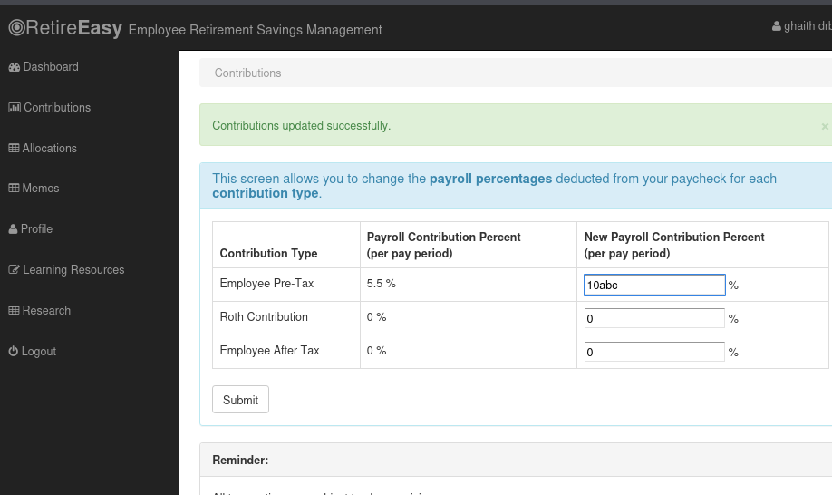
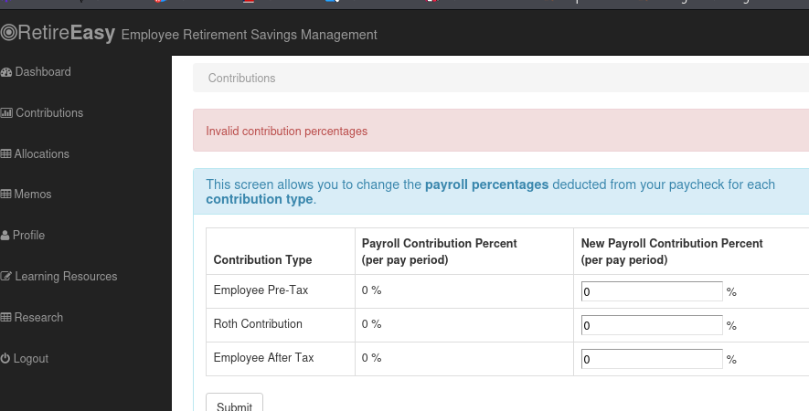
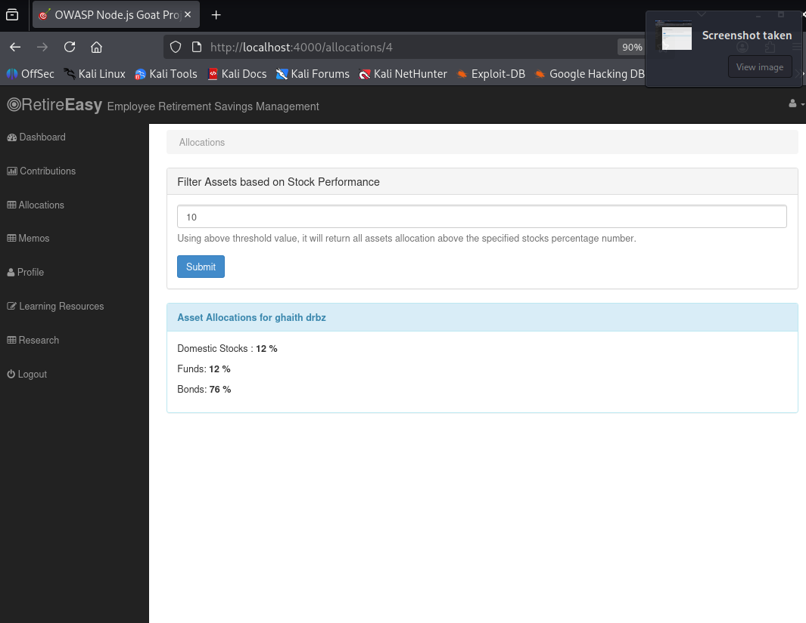
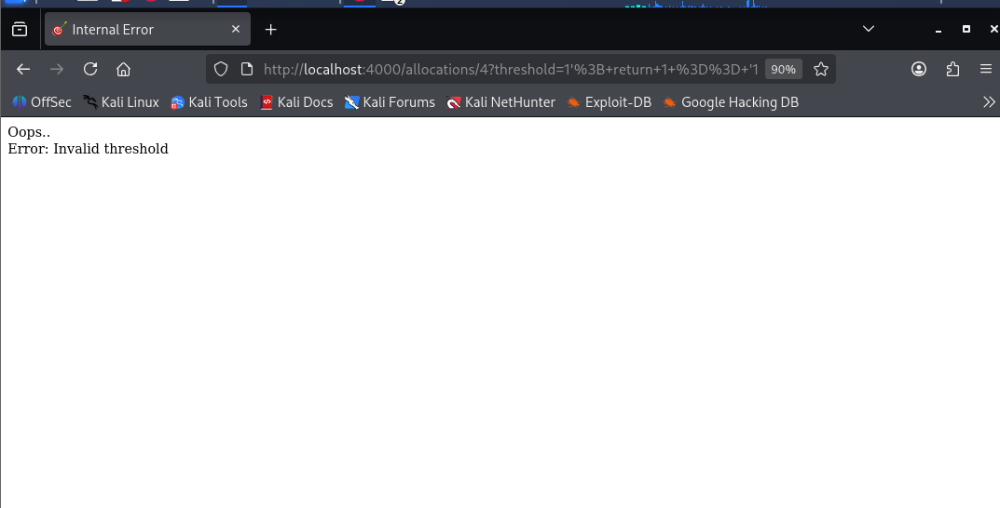
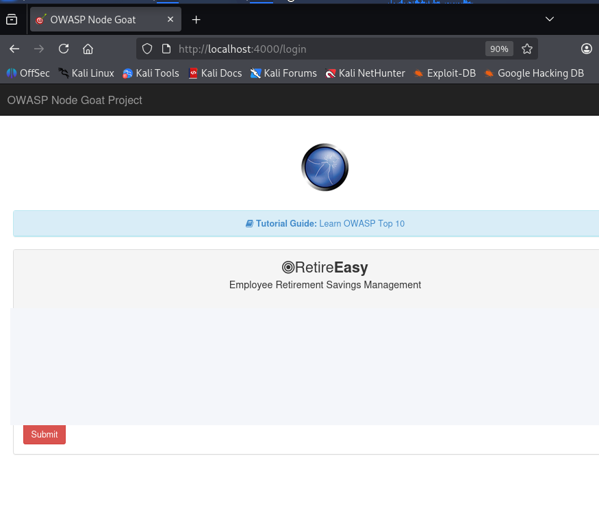
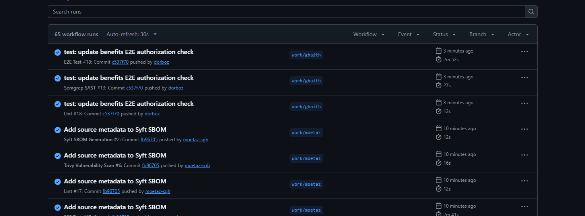
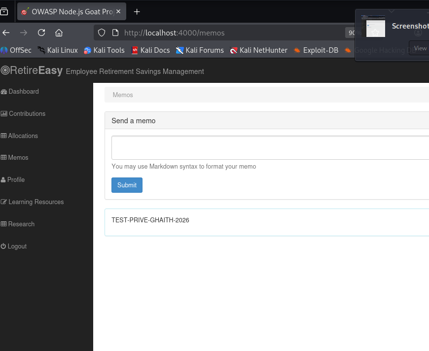
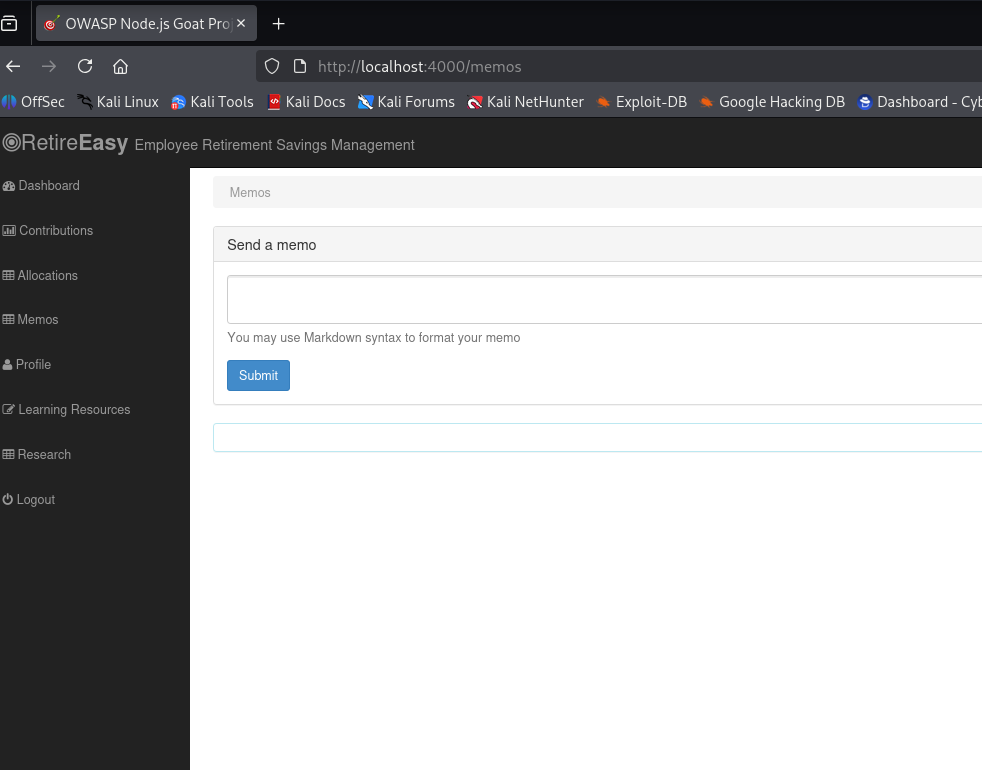
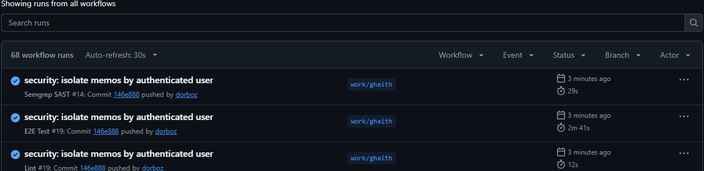

# Dossier de sécurité applicative : STRIDE et pentest BEFORE / AFTER

> OWASP NodeGoat | Contribution individuelle de Ghaith | `work/ghaith`
> Version documentaire : 03 novembre 2026
> **Périmètre :** preuves fournies dans la conversation et historique Git communiqué ; aucune action ou preuve supplémentaire inventée.

## 1. Synthèse exécutive

Quatre problèmes applicatifs ont été corrigés : (V-01) injection JavaScript dans Contributions, (V-02) injection NoSQL dans Allocations, (V-03) absence de contrôle d'accès administrateur sur Benefits et (V-04) consultation transversale des mémos. Les vérifications AFTER partagées sont positives pour les cas décrits. Le dernier commit de sécurité `146e888` sur `work/ghaith` montre Lint, Semgrep et E2E réussis.

**Limites essentielles :** pas de capture d'écran BEFORE authentifiée disponible pour chacune des quatre failles dans les fichiers actuellement accessibles ; les documents `evidence/before/*.md` apportent la preuve du code vulnérable avec les commandes Git de vérification. Le refus direct de POST `/benefits` n'a pas été testé séparément. Les quatre failles couvrent principalement **deux catégories OWASP Top 10 : A03:2021 Injection et A01:2021 Broken Access Control**. La couverture de trois catégories demandée dans le cahier des charges reste à consolider au niveau du **groupe** ; la taxonomie STRIDE ne remplace pas cette exigence.

## 2. Périmètre, hypothèses et méthode

- **Application :** OWASP NodeGoat, Node.js/Express, MongoDB, sessions applicatives, formulaires.
- **Environnement de test :** instance locale `http://localhost:4000` sous Kali Linux et Docker.
- **Actifs :** identité de session, profils, contributions, allocations, avantages administrés, mémos.
- **Frontières de confiance :** TB1 navigateur → HTTP/Express, TB2 Express → DAO, TB3 DAO → MongoDB, TB4 contributeurs Git → GitHub Actions.
- **Hypothèse de confidentialité :** le cas Memos est considéré comme un défaut d'accès si les mémos sont privés, comme retenu pour le périmètre du projet ; l'intention métier initiale n'a pas été formellement documentée.
- **Méthode :** identification de surface → observation BEFORE → correction → vérification AFTER → trace Git et CI.

## 3. STRIDE : modèle de menaces

| ID | STRIDE | Actif / frontière | Menace / scénario | Réponse et niveau de preuve |
|---|---|---|---|---|
| S-01 | Spoofing | Session, TB1 | Réutilisation ou usurpation de session | Hypothèse ; non testée directement |
| T-01 | Tampering | Contributions, TB1→TB2 | Saisie interprétée par `eval()` | V-01 corrigée ; validation numérique testée |
| T-02 | Tampering | Allocations, TB2→TB3 | Modification d'expression JavaScript MongoDB via `$where` | V-02 corrigée ; entrées malveillantes rejetées |
| R-01 | Repudiation | Journaux serveur, TB1 | Actions de modification sans traçabilité suffisante | Hypothèse ; journalisation non auditée |
| I-01 | Information disclosure | Memos, TB3 | Lecture de mémos d'autres comptes | V-04 corrigée et AFTER intercomptes observé |
| D-01 | Denial of service | MongoDB, TB3 | Exécution JavaScript coûteuse via `$where` | Risque théorique réduit, pas de déni de service démontré |
| E-01 | Elevation of privilege | Benefits, TB1 | Compte standard accède aux fonctions admin | V-03 corrigée ; GET refusé, POST à confirmer |

**Priorisation qualitative, non CVSS :** V-01 Haute (exécution dynamique sur serveur), V-02 Haute (injection dans requêtes MongoDB), V-03 Haute (modification administrative non autorisée), V-04 Moyenne/Haute (confidentialité dépendant de la sensibilité des mémos). Ces notes sont des hypothèses de traitement, pas des scores de vulnérabilité mesurés.

## 4. Correspondance OWASP Top 10 (2021)

| Cas | OWASP | Observation |
|---|---|---|
| V-01 Contributions | A03:2021 Injection | Exécution d'expression non fiable |
| V-02 Allocations | A03:2021 Injection | JavaScript MongoDB `$where` construit avec `threshold` |
| V-03 Benefits | A01:2021 Broken Access Control | Rôle admin non contrôlé sur GET/POST |
| V-04 Memos | A01:2021 Broken Access Control | Accès à des données intercomptes via `find({})` |

**Écart de conformité :** deux catégories OWASP démontrées par les quatre cas ci-dessus, au lieu des trois demandées. Une troisième catégorie doit être apportée et prouvée séparément, par exemple l'analyse des dépendances par Trivy côté Moetaz (A06 si la preuve et le traitement sont établis). Ne pas l'annoncer comme déjà validée.

## 5. Pentest BEFORE / AFTER et traçabilité

### V-01 : JavaScript Injection dans Contributions

**Emplacement :** `app/routes/contributions.js`. **BEFORE :** usage de `eval()` sur les champs saisis, donc absence de séparation entre donnée et code interprété. **Impact :** interprétation d'expressions JavaScript côté serveur. **Correction :** suppression de `eval()` ; parseur strict acceptant des décimaux avec garde de bornes et sommes. **AFTER :** six tests automatisés réussis, essais manuels dont `10abc` rejeté. **Commit :** `67964ff`.

- Avant, preuve du code : [01_contributions_code_BEFORE.md](evidence/before/01_contributions_code_BEFORE.md).
- Après, saisie `10abc` : 
- Après, message de validation : 

### V-02 : NoSQL Injection dans Allocations

**Emplacement :** `app/data/allocations-dao.js`. **BEFORE :** JavaScript MongoDB `$where` interpolant `threshold`, créé à partir d'une requête utilisateur. **Impact :** altération possible du filtre et risque d'exécution de logique coûteuse. **Correction :** contrôle strict des entrées, filtre MongoDB structuré avec `$gt`. **AFTER :** neuf tests automatisés réussis ; `0` et `10` acceptés ; `100` et les chaînes JavaScript testées rejetées avec `Invalid threshold`. **Commit :** `9b20b48`.

- Avant, preuve du code : [02_allocations_code_BEFORE.md](evidence/before/02_allocations_code_BEFORE.md).
- Après, test normal : 
- Après, rejet d'injection : 

### V-03 : Broken Access Control dans Benefits

**Emplacement :** `app/routes/index.js`. **BEFORE :** les routes `/benefits` GET et POST n'utilisaient que `isLoggedIn`. Un accès et une modification via compte ordinaire ont été rapportés lors du pentest initial. **Impact :** opérations administratives non autorisées. **Correction :** ajout de `isAdmin` sur GET et POST. **AFTER :** tentative d'accès GET par compte non admin redirigée vers `/login` ; adaptation du test Cypress devenu obsolète, puis pipeline E2E vert. **Limite :** POST direct refusé non testé séparément. **Commits :** `b2010fc`, `c537f70`.

- Avant, preuve du code : [03_benefits_code_BEFORE.md](evidence/before/03_benefits_code_BEFORE.md).
- Après : 
- CI : 

### V-04 : Confidentialité des mémos

**Emplacements :** `app/routes/memos.js`, `app/data/memos-dao.js`. **BEFORE :** mémos sans `userId` et requête `find({})` globale. La visibilité intercomptes a été rapportée. **Impact :** divulgation de mémos si leur confidentialité est requise. **Correction :** stockage de `userId` issu de la session et `find({ userId })`. **AFTER :** le mémo `TEST-PRIVE-GHAITH-2026` reste visible pour le compte A et n'est pas visible pour le compte B. **Commit :** `146e888`.

- Avant, preuve du code : [04_memos_code_BEFORE.md](evidence/before/04_memos_code_BEFORE.md).
- Après, compte A : 
- Après, compte B : 

## 6. Validation et résultats CI

| Contrôle | Dernière preuve sur `work/ghaith` | Commentaire |
|---|---|---|
| Lint | PASS, `146e888` | Vérification de code |
| Semgrep SAST | PASS, `146e888` | Analyse statique, pas une garantie d'absence de failles |
| Cypress E2E | PASS, `146e888` | Régression fonctionnelle et autorisation GET Benefits |

Les workflows Trivy, Gitleaks et SBOM observés sur `work/moetaz` ne sont pas présentés comme des vérifications du dernier commit de Ghaith. Les Security Gates réellement bloquants doivent être justifiés dans le livrable du groupe.

## 7. Limites, risques résiduels et actions

1. **Preuves BEFORE** : fournir des captures originales datant d'avant les corrections si elles sont conservées dans d'autres conversations/dossiers, ou utiliser les `git show` en pièces justificatives clairement identifiées comme preuves source.
2. **Benefits** : ajouter un test spécifique de POST non admin et vérifier l'absence de modification en base si le projet nécessite une preuve complète.
3. **Memos** : les mémos historiques sans `userId` ne seront pas visibles via le nouveau filtre ; définir une stratégie de migration/archivage avant production.
4. **Expérience utilisateur** : les seuils invalides dans Allocations produisent `Invalid threshold` sur une page d'erreur ; préférer une réponse HTTP 400 contrôlée.
5. **Couverture OWASP** : établir la troisième catégorie avec preuve sur l'application ou sur les dépendances du groupe avant de déclarer le critère atteint.
6. **Projet complet** : ajouter le pipeline bloquant, durcissement Docker/Kubernetes, deux confirmations DAST et télémétrie de test dans le rapport consolidé.
7. **Secrets** : aucune valeur réelle de secret ou clé API ne doit figurer dans le dépôt ni dans les preuves.

## 8. Contribution de Ghaith

| Commit | Contribution |
|---|---|
| `67964ff` | Suppression de `eval()` dans Contributions et validations |
| `9b20b48` | Requête paramétrée Allocations et tests de validation |
| `b2010fc` | Contrôle `isAdmin` sur GET/POST Benefits |
| `c537f70` | Test Cypress Benefits aligné avec le refus d'accès |
| `146e888` | Isolation des mémos par utilisateur authentifié |

## 9. Références et provenance

- Cahier des charges DevSecOps ING-5-SSIR, sections 4.2, 4.6, 7, fourni par l'utilisateur.
- OWASP NodeGoat, code de l'application et historique Git communiqué.
- OWASP Top 10 2021, catégories A01: Broken Access Control et A03: Injection (correspondance de classification).
- Captures fournies dans la conversation, identifiées dans [INVENTAIRE_PREUVES.csv](evidence/INVENTAIRE_PREUVES.csv) avec empreintes SHA-256.

**Note de provenance :** les extraits BEFORE reproduisent l'état du code ancien tel que fourni/décrit, et doivent être rapprochés de l'historique Git du dépôt ; il ne s'agit pas de captures de l'exploitation BEFORE. Les images AFTER sont des captures réelles fournies par l'utilisateur. Une relecture humaine est nécessaire avant dépôt universitaire, conformément aux consignes relatives à l'usage d'IA.
